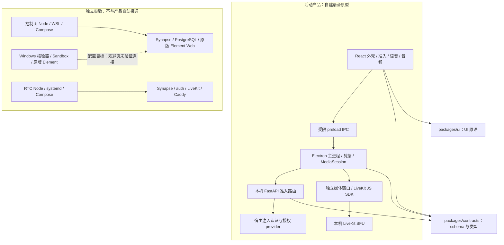
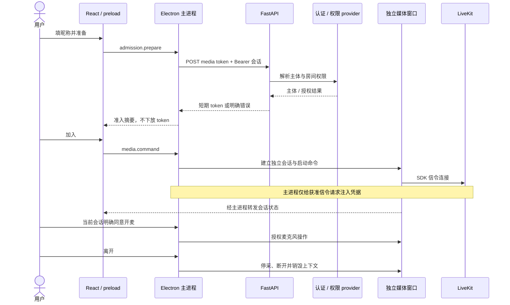
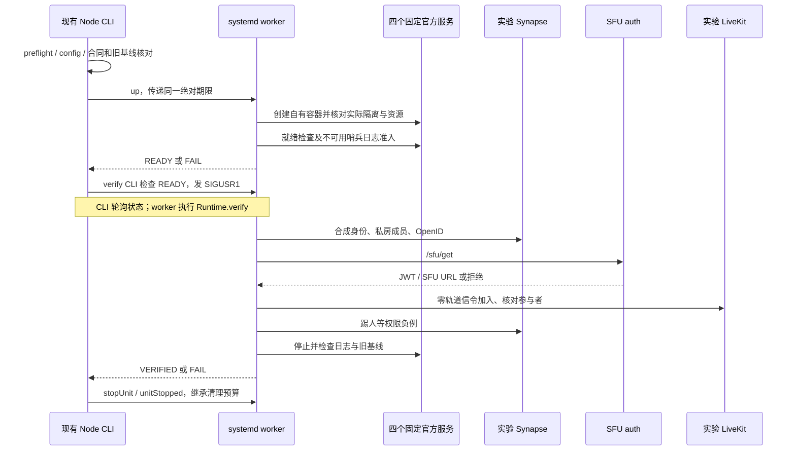

# BabaCom：当前实现架构

基线：`f4c092b8cd30db46086c3bf0f482c6168cdb4381`。本文描述实际边界，不授权框架替换、部署、清理或产品切换；产品行为摘要见 [PRD](PRD.md)，目标架构约束见 [迁移规格](docs/Matrix-migration-spec.md)。

## 系统分层与依赖

图中是源码可见的调用/数据依赖，不是运行部署已全部通过的证明。Windows 实验配置指向隔离 homeserver；其安装欢迎页验收不代表实际完成该连接。未执行全仓依赖图分析，本文不推断存在或不存在循环依赖。

| 边界 | 职责与入口 |
|---|---|
| 渲染外壳 | [renderer.tsx](apps/desktop/src/renderer.tsx)、[DesktopShell](apps/desktop/src/shell/DesktopShell.tsx) 组合现有组件；不是完整社区路由器 |
| Electron 主进程 | [main.ts](apps/desktop/src/main/main.ts) 校验 IPC 发送者、启动配置、请求及凭据；创建受限独立媒体上下文 |
| 媒体状态与执行 | [media-session.ts](apps/desktop/src/main/media-session.ts) 管状态与同意；[voice session](apps/desktop/src/features/voice/session.ts) 管 SDK；audio 负责采集/播放，不跨 feature 导入 |
| API | [factory.py](apps/api/app/factory.py) 装配认证、权限、限流、签票；普通入口不提供 fixture 回退 |
| 共享契约 | [packages/contracts](packages/contracts/) 约束媒体准入、claims 与状态；API 的 schema 读取不等于执行 TypeScript |
| 控制面实验 | [matrix-proof](infra/staging/matrix-proof/proof.mjs)：固定 WSL/容器归属、合成账号、标准客户端接口与保留数据重启 |
| Windows 实验 | [artifact](infra/staging/matrix-windows-proof/artifact.mjs)、[runtime](infra/staging/matrix-windows-proof/runtime.mjs)、[guest](infra/staging/matrix-windows-proof/guest.ps1)：签名/摘要、独占准入、VM 归属、安装及退出清理 |
| RTC 实验 | [proof](infra/staging/matrix-rtc-proof/proof.mjs)、[compose](infra/staging/matrix-rtc-proof/compose.yaml)：冻结合同、资源/日志准入、零媒体信令及归属清理 |

## 核心时序：当前产品准入与语音

异常、过期和取消也必须失效凭据；`cleanup-failed` 不是正常离开。昵称与主体不等同；客户端不签票。真实设备释放是否成功仍需物理验收。

## 核心时序：RTC 隔离证明的目标执行

这是源码意图，不是本次运行记录；不能因 `config`、`preflight`、测试或健康检查通过就认定上述时序完成。

## 状态、持久化与信任边界
- 当前产品媒体状态归主进程 `MediaSession` 管理；会话 ID 隔离迟到消息，媒体窗口是临时执行域。UI 只保留展示状态。
- FastAPI 依赖外部真实身份/授权；本实现的滚动限流在进程内，并强制一个 worker。没有证据表明当前 API 已接完整 PostgreSQL 账号库。
- Matrix 控制面账号、房间与消息属于独立实验数据库；RTC 合成账号与秘密属于自己的实验目录，不映射旧昵称身份。
- RTC 合同固定来源摘要、TLS、loopback 18443、资源/旧服务门槛；日志门先于有效票据。四容器与 Node/CLI 合计上限 1 CPU / 1.5 GiB；共享 Docker/containerd/shim 独立测量，不能声称已硬封顶。
- RTC 正常运行不超过 120 秒，清理继承同一 60 秒期限；回执确认归属后才停止资源，未知归属不可接管。旧实验与历史不重启、不覆盖、不删除。

## 维护重点与证据缺口
1. **产品和实验分离。** Matrix 没有直接接入当前 Electron/FastAPI 产品；控制面、安装和 RTC 三条证明必须分别验收，最终才谈切换和旧链退役。
2. **辅助链也有成本。** 当前 [runtimeBoundaries](infra/staging/matrix-rtc-proof/proof.mjs) 整块读取 Node 二进制做摘要，是内存尖峰候选；仅源码阅读不能确定实际故障的完整分配归因，独立分支候选不属于此基线。
3. **验证与恢复职责交织。** RTC 验证器同时承担合同、资源监测、启动、协议与清理；改进应围绕有限内存和失败时可退出的执行边界，不按文件行数机械拆分。

本文只做源码定向核对，未重跑构建/测试/云端；模拟回归不能替代真实设备、系统音频、中德网络、恢复、升级或发布验收。
