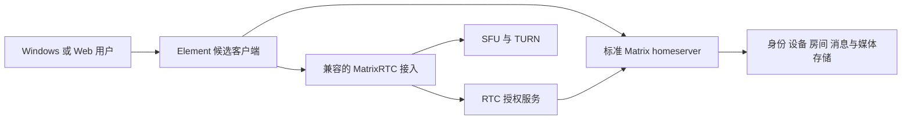

# Matrix 迁移技术规格

关联 [PRD](PRD-matrix-migration.md)、[#50](https://github.com/wenhuorongbing-netizen/babacom/issues/50)、[Backlog](Matrix-migration-backlog.md)。2026-10-13，基线 `c9ec3cf`。状态：**架构迁移提案；当前未实现 Matrix，技术 GO / 新契约签认 / 本轮 PO 复审均未完成。** 本文可用于分票和审查，不自动覆盖已签认 T1/T2，也不授权新依赖、代码删除或部署。

## 1. 决策与实验分开

| 项目 | 当前判断 | 生效/停止条件 |
|---|---|---|
| 迁移方向 | 用户授权规划标准 Matrix 主线，停止无关旧核心扩展 | 本规划发布不等于产品已切换 |
| homeserver | 首选 stock Synapse；不 fork 协议/加密核心 | 固定版本兼容、许可与运行实验通过；必要核心改动则重新决策 |
| 客户端 A | 维护中的 Element Web/Desktop 最小定制 | Windows G1 与维护预算通过后才采纳；不是预先签收 |
| 客户端 B | BabaCom UI + 官方 Matrix SDK 的窄适配作为备选 | A 失败后独立评估，不默认保留旧媒体/身份双引擎 |
| 其他客户端 | Cinny/Commet 只作比较候选 | 栈改变、SDK替换或平台未知须单独审查，不默认深 fork |
| RTC | 兼容的 MatrixRTC、RTC auth、SFU 与 TURN 链 | Matrix/Synapse 本身不等于完整媒体服务；实际兼容与撤销待测 |

候选比较必须同时说明：Windows 原生能力、E2EE/设备恢复、社区导航、部署链、自动测试、上游升级、许可及补丁边界。不能只看界面像不像 Discord。

## 2. 当前事实与可追溯来源

- 当前 BabaCom 是 Electron → FastAPI 身份/房间授权/JWT → LiveKit 的原型，不是 Matrix。PR49 已合并 UI 外壳；#18 真人验收未完成。
- [Element v1.12.30](https://github.com/element-hq/element-web/releases/tag/v1.12.30) 是本次研究固定的客户端候选。Windows Desktop 在同一仓库 `apps/desktop/`，不要基于旧归档桌面仓库开工。该版本移除旧 Module/Customisation API，并有新的 module-api 2.2；必须针对实际扩展入口设计。
- [该版本 web package.json](https://github.com/element-hq/element-web/blob/v1.12.30/apps/web/package.json) 固定 `matrix-js-sdk` 43.0.0 与 embedded Element Call 0.26.0。研究到的其他组件最新版不能拼成已验证组合。M04冻结所有版本、提交/镜像摘要、配置、锁文件及升级路径。
- 该版本 [Desktop 共享 IPC](https://github.com/element-hq/element-web/blob/v1.12.30/apps/desktop/src/ipc.ts#L151-L165) 的已检查回调只传 video；[主进程 handler](https://github.com/element-hq/element-web/blob/v1.12.30/apps/desktop/src/electron-main.ts#L376-L398) 相关路径需实验核实系统音频。这是源码缺口线索，**不是全部 Call 路径不支持音频的证明，也不是 Windows 运行结果**。
- [Matrix Client-Server API](https://spec.matrix.org/latest/client-server-api/) 是身份、设备、房间、消息与权限语义的权威来源。[matrix-js-sdk](https://github.com/matrix-org/matrix-js-sdk) 的长期客户端/crypto存储不能照搬旧一次性 partition 生命周期。
- [Element Call 自托管说明](https://github.com/element-hq/element-call/blob/main/docs/self_hosting.md) 与 [RTC auth 服务](https://github.com/element-hq/lk-jwt-service) 提供部署输入；动态 main 文档仅作研究入口，实施时换成固定提交。发现机制、homeserver支持的 MSC 与新旧 auth 模式须联调确认，不能把实验 MSC 写成全部已发布稳定协议。
- [Cinny 固定研究快照](https://github.com/cinnyapp/cinny/blob/8967c13878137841e49ee17184b689a6b4da334a/README.md) 正在替换 SDK；这增加跟随成本，不据此选择第一深 fork。

版本与许可按 **实际发货组件及固定版本** 建清单，审查 AGPL/GPL/Apache/商业条款、分发源码与 NOTICE、品牌字体资源；不把所有 Matrix 项目叫作同一种许可证，也不以本规格作法律结论。M05/M35发布前必须落实对应义务。

## 3. 目标边界：高内聚、低耦合



上图是逻辑责任图，不暗示每个客户端协议请求都经同一路径；具体发现/auth模式在 M04/M29 固定。

| 边界 | 唯一 owner / 允许接口 | 禁止累积的债务 |
|---|---|---|
| Identity / Devices / Crypto | 一个长期 MatrixClient 及其设备/密钥库；SDK官方接口 | 同库多客户端竞争、昵称当身份、独立旧 session registry 作回退 |
| Community / Rooms / Messages | Matrix ID、成员状态与 power levels；客户端应用服务 | 另建消息 WS、平行 RoomAccess/can 权威、只在 UI 隐藏权限 |
| Calls / Capture / Playback | 独立短期通话 session，受当前 generation/显式用户动作约束 | 离房销毁账号密钥库、媒体轨道塞全局业务 store、旧新播放器双持有 |
| Desktop platform | 小而明确的窗口、采集、快捷键、设备与安全 IPC 适配 | renderer直接Node/任意IPC/任意导航、平台规则散入消息模块 |
| Operations | 标准服务配置、版本固定、备份/监测与自有进程归属 | 应用内嵌第二套运维控制面、无主后台进程、未知实例清理 |
| Product presentation | 主题/品牌/i18n与必要导航扩展；状态只消费上述应用接口 | 整套复制旧UI、feature跨import、双用户/双房间模型 |

优先级：配置复用 → 文档化扩展接口 → 小型有回归的上游兼容补丁 → 重新选择方案。模块数、文件行数不是架构质量；以状态owner、依赖方向、真实替换成本与升级实验判断。不得为了“架构化”引入无消费者抽象或并行恢复框架。

## 4. 契约转换与签认

Jack 最终裁定本 fork 的迁移契约；协调者起草，独立 Reviewer 审查，原战略 PO 复审记录单独标记。M02逐条提交继任契约，必要时单独 docs PR 改 T1/T2/NFR 与模块范围；本八文件 PR 不偷偷修改那些历史规格。

| 旧假设/契约 | Matrix 继任方向 | 必须保留的验证意图 |
|---|---|---|
| 3600秒内存账号会话、重启失效 | 稳定账号、设备会话、明确登出/撤销、设备验证和恢复 | 真实身份、过期/撤销不放行、错误不泄密 |
| 120秒初始媒体JWT，旧grants及单worker滚动额度 | homeserver/RTC auth分别定义凭据TTL、能力与限流 | 最小权限、重放/错房/未授权拒绝、429与等待语义 |
| 一次性非持久媒体partition、禁设备清单 | 长期账号/crypto与短期媒体分离，允许显式设备选择 | 默认不采集、明确授权、取消晚到回调、设备变化不隐蔽重采 |
| 无自动重连 | 同步恢复与媒体重连按选定栈行为设计 | ≤10秒恢复或明确报错；不能恢复旧采集/过期权限 |
| old can/RoomAccess/provider/JWT → LiveKit | Matrix成员/权限唯一权威，RTC identity/room映射验证 | 同房/动作/主体一致、UI与直接请求一致、旧API无旁路 |
| 昵称规范 | 默认延续T1展示昵称 NFC/空格/长度/危险字符边界；身份另用Matrix ID | 两个同昵称不能互冒；上游不匹配时先签认差异，不能静默放宽 |
| 退出5秒、代次与清理归属 | 暂保留5秒总预算作为迁移目标，真实实现冻结后验证 | 自有轨道/播放器/回调停止；不杀未知实例；timeout诚实报错 |
| T1固定分发清单/旧包路径 | 新产物清单、秘密扫描、干净Windows安装启动/升级 | 真实包验证，不用开发模式代替；不通过删断言变绿 |

**M02 Ready/签认前必须填实的政策表：** 邀请寿命/次数/撤销；昵称兼容；账号/设备/RTC/恢复凭据寿命与存储；每接口/主体/IP额度、429等待；管理员移除后的新请求拒绝与**已在通话中撤销最大窗口**；公开注册/房间目录/联邦/媒体访问；共享者仲裁及标准客户端绕过策略；采集恢复/退出期限；日志/附件/密钥留存。现阶段不凭空填新TTL、限流或撤销秒数，旧路径仍活动时继续遵守其原值。

私域范围不等于自动启用联邦：默认无公开注册、公开目录或开放入群；staging限制外部访问。生产是否关闭联邦或用明确allowlist须由M02/M29测试后签认。单共享者是并发策略，不是禁用按钮；若标准客户端可绕过，必须定义可信客户端边界或服务侧强制方案并获得明确裁定，不能声称已强制。

## 5. Gate 与失败处理

| Gate | 最小证据 / 通过条件 | 未通过 |
|---|---|---|
| G0 契约和资产 | M01–M04：需求去向、真实数据清单、版本/许可、单一权威/存储owner和新契约范围已审；即将执行的实施票Ready | 其余未来票保持DRAFT，不把计划当新协议签认 |
| G1 Windows 游戏关键证明 | M05、最小M08/M09/M10/M12/M17/M18、M21/M22与获准M29环境：真实安装包双Windows，游戏画面+系统声音+独立麦克风；接收端分别调音量，无数字回授；窗口/整屏、拒绝/晚到/停止/退出/崩溃释放均有证据 | 停止扩大UI；界定缺口/补丁维护成本，A NO-GO时独立评估B，不降低Must |
| G2 单一权威纵切片 | 邀请→稳定账号→频道→消息→闭麦入房→明确开麦→离开→重入；直接API负向、成员撤销、设备/密钥恢复成立 | 旧链保留，拒绝双权威回退；无“仅UI权限”PASS |
| G3 可运行/可恢复 | M25/M26/M29–M32：固定组合，CI和真实包、权限、备份恢复、数据迁移演练、许可、成本/告警、保护新写入的回滚；一次上游升级M35 | 不进入生产切换；不足资源标HOLD，不擅自采购/发送 |
| G4 真实Alpha | M28：真人/物理/中德、高峰与强制中继；10语音/1共享/9观看≥2h；规定延迟、恢复及质量证据 | 不宣称跨境或完整Alpha通过 |
| G5 切换与观察 | M36：旧入口写入冻结、完成迁移核对、切换/回滚演练，连续两周游戏夜无回退；owner签收 | 启动回退/前向修复方案并保留新写入，不删旧活动链 |
| G6 退役与关闭 | M33/M34逐文件消费者为零、替代覆盖成立、归属/恢复验证；旧票按真实处置关闭 | 未明归属/数据/证据永不当垃圾；迁移项目保持打开 |

G1 的最小部署/身份/频道工作与 G2 有重叠，允许准备它所必需的窄切片；G2是完整安全纵切片的正式出口。读代码、合成音频、VM和CI分别可定位问题，均不替代 G1/G4 实物验收。G1前只做默认上游界面和实验必需接线。

## 6. 数据、密钥、切换与回滚

M01先盘点：每个服务/路径的账号、房间、消息、附件、配置、秘密引用、设备密钥、导出格式、数量、所有者和留存义务。只读统计，不读取无关凭据。若确无用户数据，用核对结果证明；不因为代码是原型就假设空库。

M02/M31制定身份映射和迁移清单：旧稳定ID→Matrix ID，社区/房间ID，时间/作者/权限语义，媒体/附件引用、校验和，不能按昵称匹配。加密历史迁移需实际密钥/设备支持，无法无损转换时标明范围并由owner裁定；不伪造历史作者、不假称服务端持有用户解密钥。必要工具单独提案、逐文件范围，数据库迁移仅 `_proposed/`，不写正式序列。

试迁移在隔离环境进行，导入幂等、检查点恢复、重复执行无重复数据，逐类数量/哈希/抽样可读性及权限核对；测试账号与生产资产分离。M36切换：通知/冻结旧写入→备份和最终增量→核对→切路由→只开放新权威；禁止双写两套成员/房间事实。通知、真实邮件、资源操作按届时授权执行。

回滚分三类：切换前恢复原环境；切换后无新写入可回到已验证基线；切换后有新写入必须先冻结/导出并保留 Matrix 数据和密钥，由已演练的兼容恢复/前向修复或获准的消息保留方案处理。**回旧快照不是无损回滚，旧代码不一定能读 Matrix 数据，Synapse DB不能假设支持降级。** 无法证明安全回退时暂停写入、保持新数据，执行前向修复，阻止G3/G5签收。

每日服务器DB/媒体/配置/服务身份备份与异地副本、恢复点和访问控制独立验证；RPO≤24h/RTO≤4h。设备密钥恢复另测新设备验证/恢复秘密、历史解密、丢钥提示、退出清除本地秘密及再次登录。服务器备份通过不等于用户密钥恢复通过。

## 7. 技术债与删除契约

| 旧负担 | 复用意图 | 替换/退役候选，具体删除另签 |
|---|---|---|
| FastAPI身份/准入/授权/签票 | 身份真实性、最小权限、限流、错房拒绝 | `apps/api/app/auth/session.py`、provider、permissions、tokens、ratelimit及main/factory；Matrix新拒绝链成立后M33逐文件退役 |
| admission/token/permissions schemas | 有界命令、可验证边界 | `packages/contracts/`旧schema与所有消费者映射；不能删仍活动契约 |
| desktop main/preload/voice/audio | Electron隔离、显式采集、late cancel、generation、退出归属 | `apps/desktop/src/main/`、`features/voice/`、`features/audio/`候选；这些目录名是盘点入口，**不是Allowed Files或递归删除授权** |
| UI 外壳/重复状态 | 品牌、中文、可访问与失败状态 | `packages/ui/src/index.tsx`及旧shell/token/i18n；设计目标迁入M06/M07，非逐行搬运 |
| build/dev/Sandbox helper | Job Object、期限、共享准入、未知归属不停止、原始错误 | `apps/desktop/scripts/build.mjs`、`dev.mjs`、`windows-process-owner.ps1`旧分支仅在不再使用后M34退役 |
| fixture与测试负担 | 故障可重现、秘密/取消/权限/资源负向断言 | token/voice本地fixture、合成peer、旧打包断言按M25映射；没有新覆盖不得静默删测试 |
| Python/JS重复依赖与工具 | 一套可构建可测试产品 | manifest/lock/buildconfig逐项consumer-zero，依然使用LiveKit不等于可删所有LiveKit依赖 |

删除 DoD：精确文件名单与owner→引用/运行/打包/CI消费者为零→新行为覆盖通过→可恢复基线和补丁保留→切换观察已完成→独立review→按范围删除→构建/测试/安装/升级复验。禁止whole-directory清扫、测试skip/改期限掩盖回归、以.gitignore当垃圾名单。历史 `.pm/`、evidence/artifacts、build中原生失败证据只追加。

#41在 `merge-main` 的 playback与microphone测试两文件dirty必须原样保留；部分delta测试通过不等于≤1000ms freshness/挂起查询问题解决。M34退役前将补丁保存到可恢复提交/存档并校验，不能reset/覆盖。#40/#31/#42的旧helper若仍活动且泄漏，继续原精确修复；若不再活动则带证据按superseded关闭，不能编造补跑PASS。

## 8. 测试转换与证据层级

| 层级 | 新链验证 | 保留/改写的旧意图 |
|---|---|---|
| 静态/单元 | 类型、lint、依赖方向、权限/状态纯逻辑、配置schema | 有界接口、单owner、旧回调无效；不声称声音可听 |
| 真实服务集成 | homeserver+auth+SFU、两个账号、直接API越权/撤销、消息同步、429 | 不回退fixture、身份/房间一致、错误脱敏；旧TTL改写需签认 |
| 客户端/桌面旅程 | 上游真实UI、Electron隔离/IPC/导航、加入取消、断线重连、设备恢复 | 默认零采集、晚授权不publish、重复点击/播放器无重复、当前收包而非累计字节 |
| 打包/原生 | 干净Windows安装启动、权限拒绝、热插拔、睡眠、崩溃退出、升级 | 自有进程/轨道释放、失败码/清理期限、不清理未知实例、跨进程争用 |
| 真人/网络/负载 | 两真实Windows听音与设备释放；中德、高峰/强制TURN、10/1/9≥2h | #18与NFR保留，人耳和物理释放不被VM合成媒体替代 |
| 运维/恢复/升级 | 隔离备份恢复、密钥恢复、切换新写入保护、一次上游升级及兼容回退 | 数据不丢、RPO/RTO、来源/许可、版本可追溯 |

M25将每条旧断言标记 KEEP/REWRITE/RETIRE并附继任测试、契约依据和owner；不是全量复制旧测试。上游测试通过只覆盖其声明范围。M01逐条核对24模块和139项历史未勾验收的去向；数量是规划输入，不视作139个待修bug。

当前旧栈命令只用于仍活动的旧代码，cwd为仓库根：

```powershell
npm.cmd run typecheck --workspace apps/desktop
npm.cmd run lint --workspace apps/desktop
npm.cmd run test --workspace apps/desktop
npm.cmd run build --workspace apps/desktop
npm.cmd run package:win --workspace apps/desktop
npm.cmd run test:e2e --workspace apps/desktop
```

API的cwd为`apps/api`，命令为`uv run python -m pytest ../../tests/tokens ../../tests/ratelimit ../../tests/accounts ../../tests/permissions -v`。
新Element票Ready时，必须从固定HEAD的package scripts/CI冻结**各自真实完整命令、cwd、环境、通过数量和退出码**；不假造未建立的 `test:matrix`，不拿旧命令签收新fork。本规划只运行docs边界/一致性校验，产品测试 **NOT_RUN**。

自动化优先复用上游的单测、真实MatrixRTC E2E后端与账号fixture，固定版本/测试账号/房间，隔离并发数据；CI先跑快速纯逻辑与真实服务负向，再跑Windows包、网络故障与升级恢复。干净VM适合安装/打包/协议和可控设备模拟；真实双Windows仅在G1及G4集中验证系统声、人耳/物理释放和实际中德网络。测试素材与已生成证据分离，避免每次手动重搭整个Sandbox链或无限复制日志；执行失败保存最小可复现材料和原始错误，不修改旧历史证据。

M25另跑Chrome/Edge Web访客邀请、登录、消息、闭麦语音、收听/观看、权限拒绝与关页退出旅程，明示与Windows全局快捷键/系统音频差异。M27把终端自动更新与M35开发侧上游升级分开：验证获准更新源、签名/哈希、坏包拒绝、失败可启动、重启后账号/密钥/历史保全；崩溃诊断默认本地脱敏，外发明确选择，不含秘密或原始音频。

既有NFR延迟：同区目标<150ms、>300ms不可接受；中德目标<300ms、>500ms不可接受；恢复≤10s或明确报错。旧README里通用FEC/丢包百分比是待重新研究的历史假设，不能作为所有实现保证；M32按固定组合测量校准，改变阈值须独立签认，不能降低Must使其通过。

## 9. 运行、许可与维护成本

staging链包括homeserver/DB/媒体、发现与TLS、兼容auth、SFU/TURN、备份和监测；没有容器/节点条件时标HOLD，不从配置存在推断部署成功。负载、区域标签、强制中继和连接质量数据来自真实连接，不由前端假数据填充。

成本拆分：主机/数据库、SFU出站、TURN重复转发、附件/备份存储、邮件、Windows构建/签名、域名TLS、监测与每次上游升级工时。M32按北京时间21点及2/6/10人、共享档位实测；配额80%告警、日志≤14天、附件90天策略、无第三方遥测/录制逐项验证。无法清除上游外发数据时列差距，不宣称关闭。

M30包括国内可访问状态页以及IP被墙、证书过期、磁盘满、DB故障、流量超额的事故步骤/owner和演练；不泄露私群成员或秘密。M31验证获准备用IP/域名、客户端端点切换与季度恢复排期，保持Matrix server_name、ID、服务密钥和TLS信任，不假定更换homeserver域名能保留原身份。M31所需M14存储/迁移子集在Ready时拆为独立可验收实施票并更新依赖；未拆前保守保留原全票依赖，不提前旁路或承诺整个R03附件宽度。

补丁预算不是虚构行数：每补丁记录需求、扩展层、风险owner、回归、上游提交可能性和升级重放。进入协议/加密核心或必须长期大改Call时暂停采纳并重评路径；一次真实上游升级证明维护能力后，才可签收M35。
